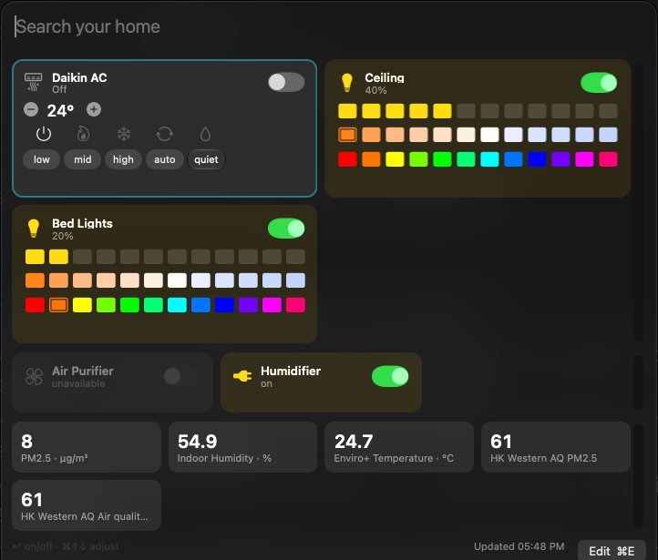

# Home Assistant for Alfred

Control your Home Assistant devices from an Alfred 6 panel.

## Usage

Open the panel via the `home` keyword.

- Search and pin any device or sensor with <kbd>⌘</kbd><kbd>E</kbd>.
- Each device gets the controls Home Assistant says it supports: brightness, warmth and colour bars for lights; temperature, mode and fan speed for climate; menus for effects, sources and any `select`; a bar for any `number` marked as a slider.
- Sensors show as reading cards.
- <kbd>↩</kbd> turns the selected device on or off. <kbd>⌘</kbd><kbd>↑</kbd> / <kbd>⌘</kbd><kbd>↓</kbd> adjusts it.
- Right-click a tile to turn it on or off or remove it.
- If Home Assistant can't be reached, the panel shows the last saved states.

## Setup

1. In Home Assistant, click your name (bottom left) › Security › Create token, and copy it.
2. In Alfred, open the workflow's Configure Workflow and paste your Home Assistant address and the token.
3. Allow Alfred on your local network if macOS asks.

## Testing without a home

Save the output of `GET /api/states` to a file and set the workflow variable `ha_mock` to its path. The panel reads that file and sends no commands.
